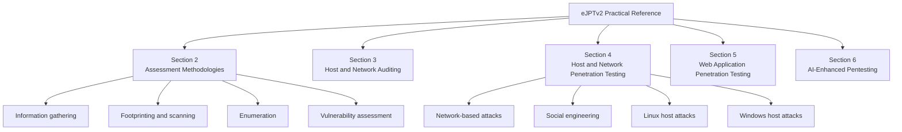
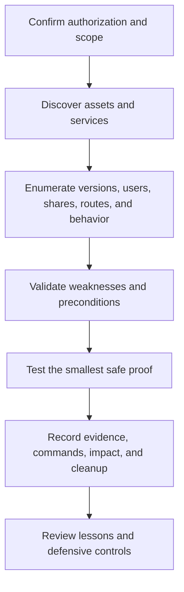

# eJPTv2 ARAJAA Practical Reference

**Structured penetration-testing notes created and maintained by Ahmad Araja (ARAJAA).**

This repository turns my eJPTv2 learning journey into a practical reference for assessment methodology, service enumeration, vulnerability analysis, host and network exploitation, privilege escalation, web testing, and AI-assisted workflows.

> [!IMPORTANT]
> This is an unofficial community resource. It is not affiliated with, endorsed by, or sponsored by INE Security. Use every technique only in systems you own or have explicit authorization to test.

## Learning path

```mermaid
flowchart LR
    INFO["Information gathering"] --> SCAN["Footprinting and scanning"]
    SCAN --> ENUM["Service enumeration"]
    ENUM --> VULN["Vulnerability assessment"]
    VULN --> AUDIT["Host and network auditing"]
    AUDIT --> EXPLOIT["Authorized exploitation"]
    EXPLOIT --> POST["Credentials and privilege escalation"]
    POST --> WEB["Web application testing"]
    WEB --> AI["AI-enhanced workflow"]
```



## Repository map



## Quick navigation

### Section 2 - Assessment Methodologies

| Area | Notes |
|---|---|
| Information gathering | [Passive](<SECTION 2 Assessment Methodologies/Information Gathering course/Passive Information Gathering.md>) · [Active](<SECTION 2 Assessment Methodologies/Information Gathering course/Active Information Gathering.md>) |
| Footprinting and scanning | [Host discovery](<SECTION 2 Assessment Methodologies/Footprinting & Scanning/Host Discovery.md>) · [Port scanning](<SECTION 2 Assessment Methodologies/Footprinting & Scanning/Port Scanning.md>) · [Firewall and IDS evasion](<SECTION 2 Assessment Methodologies/Footprinting & Scanning/Firewall Detection & IDS Evasion.md>) |
| Enumeration | [Service enumeration](<SECTION 2 Assessment Methodologies/Enumeration/Service Enumeration.md>) · [Nmap NSE](<SECTION 2 Assessment Methodologies/Enumeration/Nmap Scripting Engine (NSE).md>) · [NetExec](<SECTION 2 Assessment Methodologies/Enumeration/NetExec.md>) |
| Vulnerability assessment | [Assessment](<SECTION 2 Assessment Methodologies/Vulnerability Assessment/Vulnerability Assessment.md>) · [Scanning](<SECTION 2 Assessment Methodologies/Vulnerability Assessment/Vulnerability Scanning.md>) · [Analysis](<SECTION 2 Assessment Methodologies/Vulnerability Assessment/Vulnerability Analysis.md>) |

### Section 3 - Host and Network Auditing

- [Security auditing](<SECTION 3 Host & Networking Auditing/Security Auditing/Security Auditing.md>)

### Section 4 - Host and Network Penetration Testing

| Area | Notes |
|---|---|
| Network attacks | [SMB exploitation, pivoting, SNMP, relay, DNS and ARP scenarios](<SECTION 4 Host & Network Penetration Testing/Network-Based Attacks/Network Attacks.md>) |
| Social engineering | [Social-engineering notes](<SECTION 4 Host & Network Penetration Testing/Social Engineering/Social Engineering.md>) |
| Linux exploitation | [Exploiting Linux vulnerabilities](<SECTION 4 Host & Network Penetration Testing/System Host Based Attacks/Linux/Exploiting Linux Vulnerabilities.md>) |
| Linux credentials | [Linux credential dumping](<SECTION 4 Host & Network Penetration Testing/System Host Based Attacks/Linux/Linux Credential Dumping.md>) |
| Linux escalation | [Linux privilege escalation](<SECTION 4 Host & Network Penetration Testing/System Host Based Attacks/Linux/Linux Privilege Escalation.md>) |
| Windows exploitation | [Exploiting Windows vulnerabilities](<SECTION 4 Host & Network Penetration Testing/System Host Based Attacks/Windows/Exploiting Windows Vulnerabilities.md>) |
| Windows credentials | [Windows credential dumping](<SECTION 4 Host & Network Penetration Testing/System Host Based Attacks/Windows/Windows Credential Dumping.md>) |
| Windows escalation | [Windows privilege escalation](<SECTION 4 Host & Network Penetration Testing/System Host Based Attacks/Windows/Windows Privilege Escalation.md>) |

### Section 5 - Web Application Penetration Testing

- [Web application penetration testing](<SECTION 5 Web Application Penetration Testing/Web Application Penetration Testing.md>)

### Section 6 - AI-Enhanced Pentesting

- [AI-enhanced penetration-testing concepts](<SECTION 6 AI Enhanced Pentesting/AI Enhanced Pentesting.md>)

## Methodology



The notes are organized around repeatable workflows rather than isolated commands:

1. Establish legal authorization, target scope, and objective.
2. Gather passive and active information.
3. Discover hosts, ports, services, and trust relationships.
4. Enumerate each exposed service before selecting an exploit path.
5. Validate vulnerability preconditions instead of trusting scanner labels alone.
6. Use the least destructive proof required by the lab.
7. Record commands, evidence, findings, and remediation lessons.

## Use locally

Read directly on GitHub, or clone for local search and Obsidian navigation:

```bash
git clone https://github.com/0xarajaa/eJPTv2-ARAJAA-Practical-reference.git
cd eJPTv2-ARAJAA-Practical-reference
```

Search every Markdown file from a terminal:

```bash
rg -n "SMB|privilege escalation|Nmap" -g "*.md"
```

## Scope and safety

Some notes discuss exploitation, credential access, spoofing, brute-force testing, and privilege escalation. Context matters:

- Use only in labs, CTFs, owned systems, or explicitly authorized engagements.
- Verify versions, configuration, and preconditions before running a module.
- Prefer non-destructive validation.
- Do not treat scanner output as proof of exploitability.
- Document cleanup and restore changed lab state when appropriate.

## Feedback

Corrections and useful improvements are welcome through issues or pull requests. Do not submit credentials, private targets, exam answers, proprietary course material, or unauthorized data.

## Author

Created and maintained by **Ahmad Araja (ARAJAA)**.

[Connect with me on LinkedIn](https://www.linkedin.com/in/ahmadaraja)
